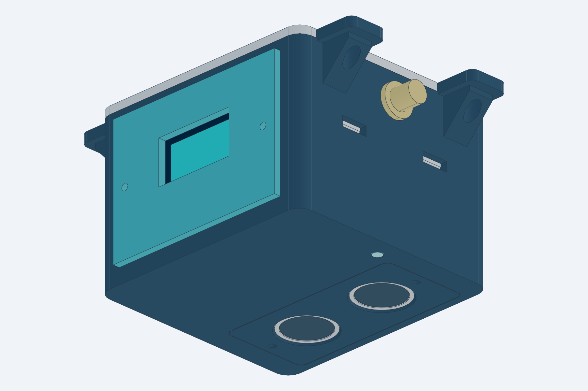
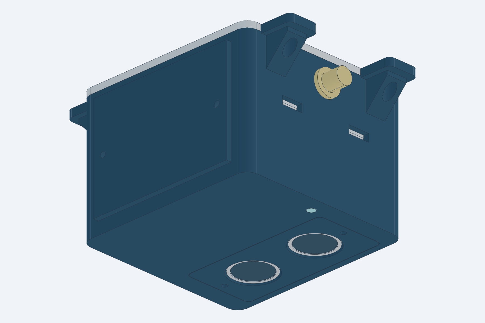
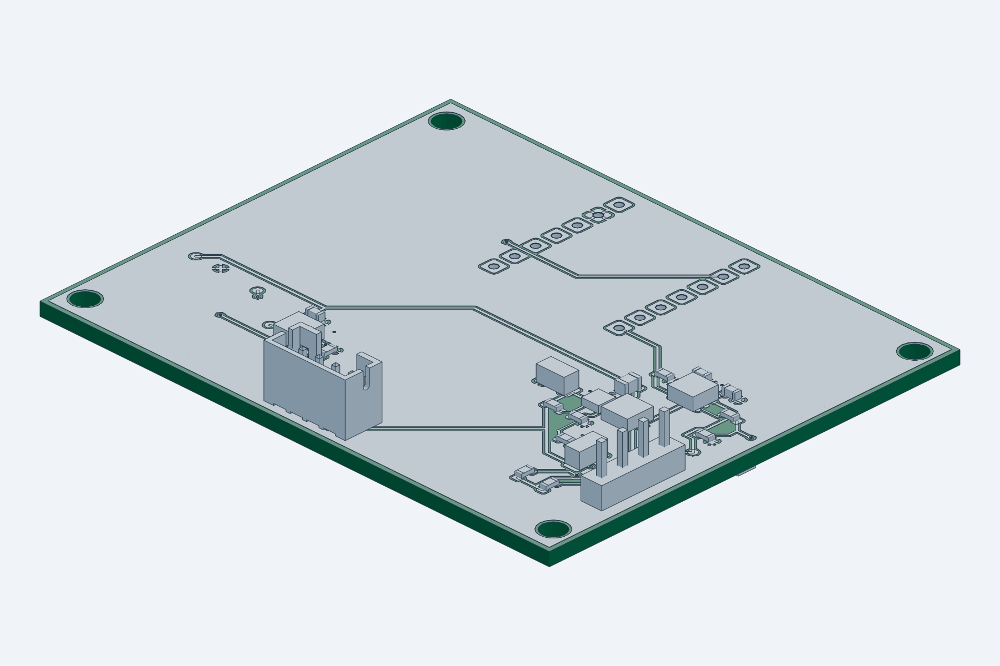
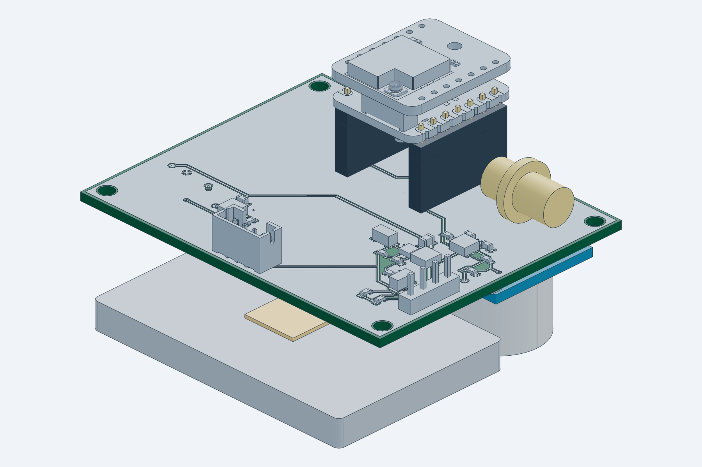

# SmartPark

### A compact ceiling-mounted parking node

XIAO ESP32S3 · Wio-SX1262 LoRa · HC-SR04 · LiPo · optional OLED

**Rev D indoor pilot — digitally checked, awaiting physical validation**

[Download PCB](https://github.com/RAJ-IITROORKEE/smart-park-design/releases/download/revd-pilot/SmartPark-RevD-PCB-Fabrication.zip) · [Download case](https://github.com/RAJ-IITROORKEE/smart-park-design/releases/download/revd-pilot/Case-Print-Files.zip) · [Build guide](docs/SmartPark-RevD-Build-Guide.md) · [3D models](previews/README.md)

**[Watch the product video](https://github.com/RAJ-IITROORKEE/smart-park-design/raw/refs/heads/main/media/showcase/brag.mp4)**

SmartPark is a hardware design for an indoor parking-bay occupancy node. Mount it above the bay with the ultrasonic faces pointing down; parking firmware can compare the measured distance with an empty-bay baseline and report changes over LoRa. The target installation height is up to **2.8 m**.

This repository contains the carrier PCB, two enclosure variants, editable CAD, fabrication exports and illustrated assembly guides. **Parking firmware, a LoRa gateway and a dashboard are not included.**

## The finished design

| With OLED | Without OLED |
|:---:|:---:|
|  |  |
| Aisle-facing 0.96-inch display and bottom status light pipe | Closed front panel and programmable RGB indication |
| [GLB](previews/04-complete-product/product_oled.glb) · [STEP](previews/04-complete-product/product_oled.step) | [GLB](previews/04-complete-product/product_status.glb) · [STEP](previews/04-complete-product/product_status.step) |

| Carrier PCB | Connected electronics |
|:---:|:---:|
|  |  |
| [PCB GLB](previews/01-pcb/pcb-carrier.glb) · [PCB STEP](previews/01-pcb/pcb-carrier.step) | [Stack GLB](previews/02-connected-electronics/electronics-stack.glb) · [Stack STEP](previews/02-connected-electronics/electronics-stack.step) |

**62 × 50 mm carrier** · **70 × 66 × 50.4 mm closed body** · **94 mm width including mounting ears**

The case conceals the HC-SR04 board and exposes only its two transducer faces underneath, alongside the RGB light pipe. The OLED faces the aisle. These are CAD previews of intended assembly; solder fillets, wiring and some purchased-part details are not modeled.

## Downloads

| What you need | Direct download | Read before use |
|---|---|---|
| PCB manufacturing files | **[Gerbers and drills ZIP](https://github.com/RAJ-IITROORKEE/smart-park-design/releases/download/revd-pilot/SmartPark-RevD-PCB-Fabrication.zip)** | [Board fabrication notes](docs/FABRICATION.md) |
| Case print files | **[STL and 3MF ZIP](https://github.com/RAJ-IITROORKEE/smart-park-design/releases/download/revd-pilot/Case-Print-Files.zip)** | [Part selection and assembly](docs/BUILD_AND_RELEASE.md) |
| Everything together | **[Complete RevD project ZIP](https://github.com/RAJ-IITROORKEE/smart-park-design/releases/download/revd-pilot/SmartPark-RevD-Complete.zip)** | Includes PCB sources, models, guides and videos |
| Illustrated build manual | [Word document](https://github.com/RAJ-IITROORKEE/smart-park-design/raw/refs/heads/main/docs/SmartPark-RevD-Build-Guide.docx) · [Markdown](docs/SmartPark-RevD-Build-Guide.md) | Parts, soldering, wiring, battery and firmware connections |
| Connection schematic | [PNG](outputs/schematics.png) · [PDF](outputs/schematics.pdf) · [SVG](outputs/schematic-svg/SmartMark.svg) | [GPIO map](docs/PINOUT.md) |
| Editable PCB project | [KiCad project folder](hardware) | Open SmartMark.kicad_pro |
| All 3D views | [Organized model index](previews/README.md) | Carrier, electronics, enclosure-only and complete assemblies |

[View the RevD pilot release](https://github.com/RAJ-IITROORKEE/smart-park-design/releases/tag/revd-pilot). File integrity is recorded in [SHA256SUMS.txt](SHA256SUMS.txt).

The same Gerbers serve both variants. For OLED use [BOM.csv](outputs/BOM.csv) and [SMD placements](outputs/placements-smd.csv). For no OLED use [BOM-no-OLED.csv](outputs/BOM-no-OLED.csv) and [matching placements](outputs/placements-smd-no-OLED.csv); omit J2, R8 and R9. A bare fabricated board still needs its electronic parts assembled.

## PCB front and back

| Front copper and silkscreen | Back copper and silkscreen |
|:---:|:---:|
|  |  |
| [Front SVG](previews/01-pcb/pcb-front.svg) · [Assembly SVG](previews/01-pcb/assembly-front.svg) | [Back SVG](previews/01-pcb/pcb-back.svg) · [Assembly SVG](previews/01-pcb/assembly-back.svg) |

Two copper layers, 1.6 mm FR4 and 35 µm nominal copper. **D1 RGB and C7 mount on the underside.** The back preview is mirrored to show the underside; upload fabrication Gerbers and drills unchanged.

## Components

| Qty | Component | Role | Product or ordering reference |
|:---:|---|---|---|
| 1 kit | **XIAO ESP32S3 + Wio-SX1262**, SKU 102010611 | Controller, LoRa radio and battery charging | [Seeed](https://www.seeedstudio.com/Wio-SX1262-with-XIAO-ESP32S3-p-5982.html) · [Robocraze](https://robocraze.com/products/xiao-esp32s3-wio-sx1262-kit-for-meshtastic-lora) |
| 1 | **HC-SR04** | Downward-facing ultrasonic range measurement | [Robu SKU 2444](https://robu.in/product/hc-sr04-ultrasonic-range-finder/) |
| 0 or 1 | **GoldenMorning GME12864-11 OLED** | Optional 0.96-inch 128×64 SSD1306 I²C display | [Robu SKU 617725](https://robu.in/product/0-96-inch-i2c-iic-oled-lcd-module-4pin-with-vcc-gnd-white/) |
| 1 | **Protected 1S LiPo**, target 1500 mAh | 3.7 V battery, within the 51 × 34 × 5 mm reference envelope | [Pack candidate](https://probots.co.in/lithium-ion-rechargeable-battery-3-7v-1500mah-kp-053450.html); confirm total dimensions and protection |
| 1 | **WS2812B-2020-V6**, D1 | Programmable RGB status through a light pipe | [Exact V6 pixel](https://lcscindia.com/part/WS2812B-2020-V6) |
| 1 | **TPS61099DRVR**, U2 | Switched 5 V sensor and RGB supply | [TI](https://www.ti.com/product/TPS61099) |
| 1 | **SN74LVC1G17DBVR**, U4 | Buffers the sensor ECHO into 3.3 V logic | [TI](https://www.ti.com/product/SN74LVC1G17) |
| 1 | **SN74LVC1T45DBVR**, U3 | Translates RGB data to switched 5 V | [TI](https://www.ti.com/product/SN74LVC1T45) |
| 1 | **VLS3012CX-2R2M-1**, L1 | 2.2 µH boost inductor | [TDK](https://product.tdk.com/en/search/inductor/inductor/smd/info?part_no=VLS3012CX-2R2M-1) |
| 1 set | Capacitors, resistors, sockets and cables | Carrier assembly and modular connections | [Complete parts table with links](docs/parts-and-product-links.csv) · [Electrical BOM](docs/BOM.md) |
| optional | **DFRobot FIT0601** regulated solar panel | External regulated 5 V USB input | [DFRobot](https://www.dfrobot.com/product-1774.html) · [Evelta](https://evelta.com/monocrystalline-solar-panel-5v-1a/) |

Product links are sourcing references, not guarantees of stock or sample fit. Confirm the battery, socket/header stack, sensor and display before buying a batch. U2 has a 2 × 2 mm exposed-pad package and needs a controlled reflow process.

## The enclosure

  

Four releasable snap clips lock the lid. The removable front panel and sensor retainers use screws. Four 4.5 mm mounting holes have **82 × 42 mm** center spacing.

| Version | Installed printed parts |
|---|---|
| **OLED — 7 parts** | base, lid, sensor_mask, sensor_retainer, light_pipe, front_oled, oled_retainer |
| **No OLED — 6 parts** | base, lid, sensor_mask, sensor_retainer, light_pipe, front_blank |
| Trial print | fit_coupon; not installed in the product |

<strong>See all print parts and enclosure-only CAD</strong>

- [OLED case only — GLB](previews/03-enclosure/case-oled.glb) · [STEP](previews/03-enclosure/case-oled.step)
- [No-OLED case only — GLB](previews/03-enclosure/case-no-oled.glb) · [STEP](previews/03-enclosure/case-no-oled.step)
- [Individual STL files](cad/STL) · [3MF files](cad/3MF) · [Print measurements](docs/PRINT_CHECK.md)

Start with PETG, 0.2 mm layers, a 0.4 mm nozzle and four walls. Print the coupon first, inspect supports in the slicer and keep clip gaps free. Use clear PETG or a suitable 3 mm clear rod for the light pipe. Print individual parts; complete product assemblies include electronics and are not whole-product print files.

## Power and battery

The LiPo sits **beneath the carrier PCB**, toward the front panel and next to the ultrasonic sensor. Use a protected **3.7 V single cell**, target **1500 mAh** (about 5.55 Wh nominal), within the **51 × 34 × 5 mm** reference envelope, plus 1 mm insulating foam and a nonconductive strap.

**There is no battery socket on the carrier.** Solder a matching protected-pack lead to the XIAO BAT+ and BAT− pads before mating the Wio module. Confirm polarity, PCM dimensions, pouch seals and lead clearance.

External solar support uses a **regulated 5 V USB output into XIAO USB-C**. Use solar or service USB one at a time. The XIAO is the only cell charger; the carrier contains no raw-panel input or MPPT controller.

<strong>Battery placement image and runtime assumptions</strong>

| Sampling interval | Modelled runtime on 1500 mAh |
|---|---:|
| Every 5 seconds | approximately 12–32 days |
| Every 10 seconds | approximately 23–61 days |

These are unmeasured scenarios with 80% usable capacity, deep sleep, brief sensing and LED flashes, OLED off or omitted, and occasional short LoRa reports. **Continuous RGB keeps the shared sensor supply on** and can reduce the modelled runtime to about 20–40 hours. Wi-Fi, continuous display, radio receive and retries also increase demand.

See [all assumptions and calculations](docs/SmartPark-RevD-Build-Guide.md#estimated-battery-runtime). Seeed lists 50 mA charging on its general XIAO page and 100 mA on the kit page; confirm the delivered board before estimating recharge time. Larger packs or an 18650 require a new fit check or case revision.

## Wiring and programming

| Function | Connection |
|---|---|
| HC-SR04 TRIG | J1 pin 2 → D0 / GPIO1 |
| HC-SR04 ECHO | J1 pin 3 → U4 buffer → D1 / GPIO2; never raw 5 V ECHO to MCU |
| Sensor supply | J1 pin 1: switched 5V_SENSOR; pin 4: GND |
| Sensor and RGB supply enable | D3 / GPIO4, active high |
| OLED | J2 pins 1 GND, 2 3V3, 3 SCL / GPIO6, 4 SDA / GPIO5 |
| Onboard RGB data | D6 / GPIO43 through U3; one WS2812B-2020-V6 |
| Firmware upload | XIAO USB-C data cable; XIAO ESP32S3 target; disconnect external solar |

Keep BOOST_EN low during startup, initialize TRIG and RGB data low, then enable the supply and wait at least 60 ms before sensing. Leave D2 / GPIO3 unused and reserve D8–D10 for Wio.

The module stack needs two 8.5 mm female sockets, 2.5 mm male header shoulders and a **0.6 mm air gap above the male plastic**, set with a removable soldering shim. Carrier-to-XIAO PCB separation is 11.6 mm; male short legs must be at least 3 mm. Use the XIAO's 14 edge pads, not Wio's radio-only outer rows.

[Full pin orientation](docs/PINOUT.md) · [Connection schematic](outputs/schematics.png) · [Step-by-step build guide](docs/SmartPark-RevD-Build-Guide.md)

## Validation and intended use

| Digital check | Retained result |
|---|---|
| Native KiCad ERC / DRC | 0 reported violations |
| Unrouted connections / schematic parity | 0 / 0 |
| Independent critical package-pin checks | 42 |
| CAD checks | 116; no failures, one unverified commodity sensor dimension assumption |
| Individual printable meshes | 9 closed meshes |
| Source and export integrity | Recorded SHA256 hashes and [delivery check](verification/delivery-check.json) |

Checks apply to the delivered rule configuration, including documented ignored categories. They do not establish physical qualification.

**RevD is an unbuilt indoor pilot.** HC-SR04 has a nominal 4 m range; it is not a 5 m or weatherproof sensor. Calibrate at the actual installation and test different vehicle roofs, adjacent bays, echo timeouts, temperature and mounting angle. Physical fit, electrical startup, RF, battery runtime, latch life and mounting strength still require first-article validation. Resolve India-specific radio settings and equipment requirements before deployment.

## Find your files

| Folder | Contents |
|---|---|
| [hardware](hardware) | Editable KiCad project, schematic, PCB and local libraries |
| [outputs](outputs) | Fabrication exports, schematic images, BOM and placement tables |
| [cad](cad) | Parametric sources, STEP, GLB, STL, 3MF and geometry checks |
| [previews](previews/README.md) | Numbered carrier, electronics, enclosure and full-product previews |
| [docs](docs) | Illustrated Word/Markdown guides, procurement, power and print notes |
| [media](media/README.md) | Showcase video, poster, animation and original recording |
| [verification](verification) | Electrical, mechanical, document and release evidence |

The short showcase was made with [/brag](https://github.com/RAJ-IITROORKEE/smart-park-design/tree/main/media/showcase) and Hyperframes using the real CAD preview images. It presents the design intent, not a demonstration of working deployed hardware.
