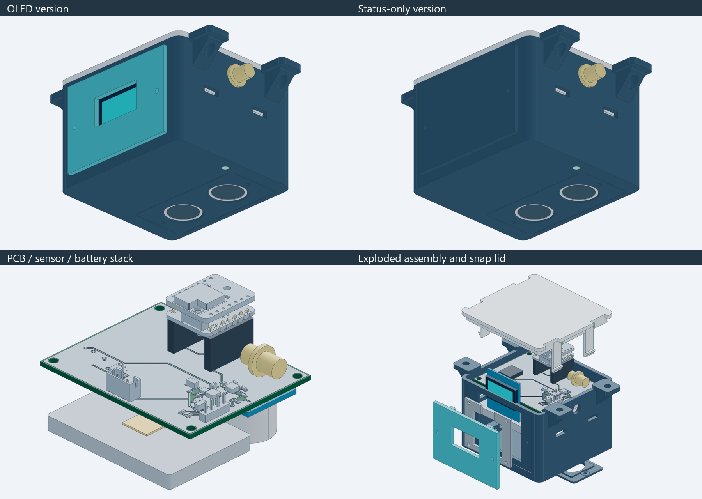
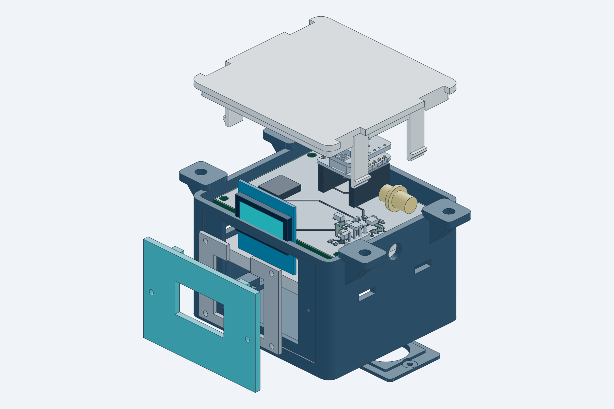
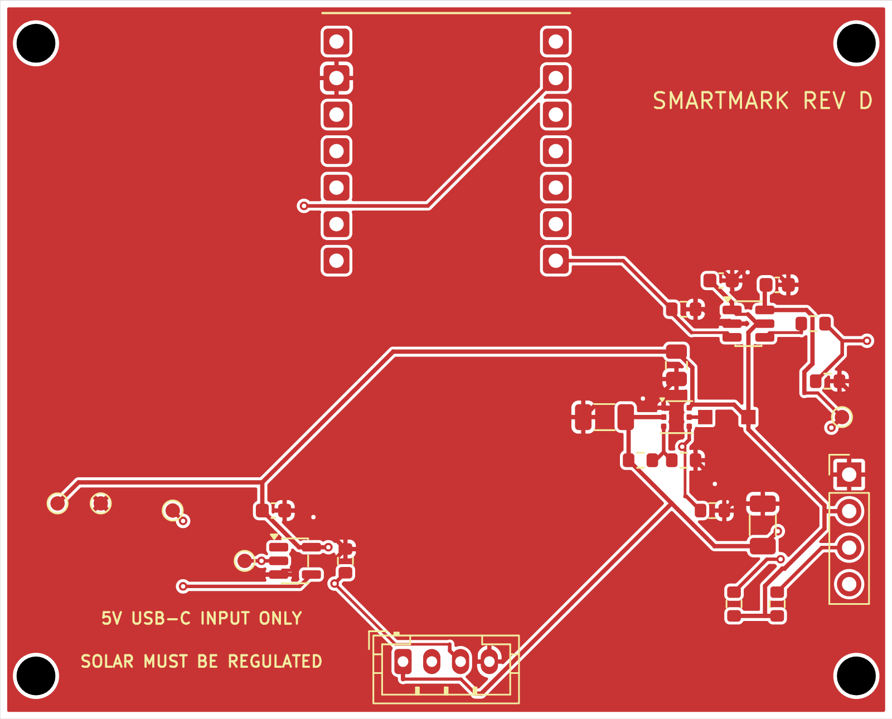
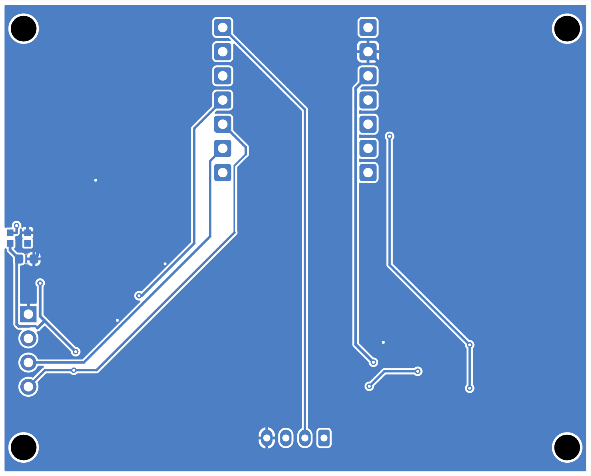
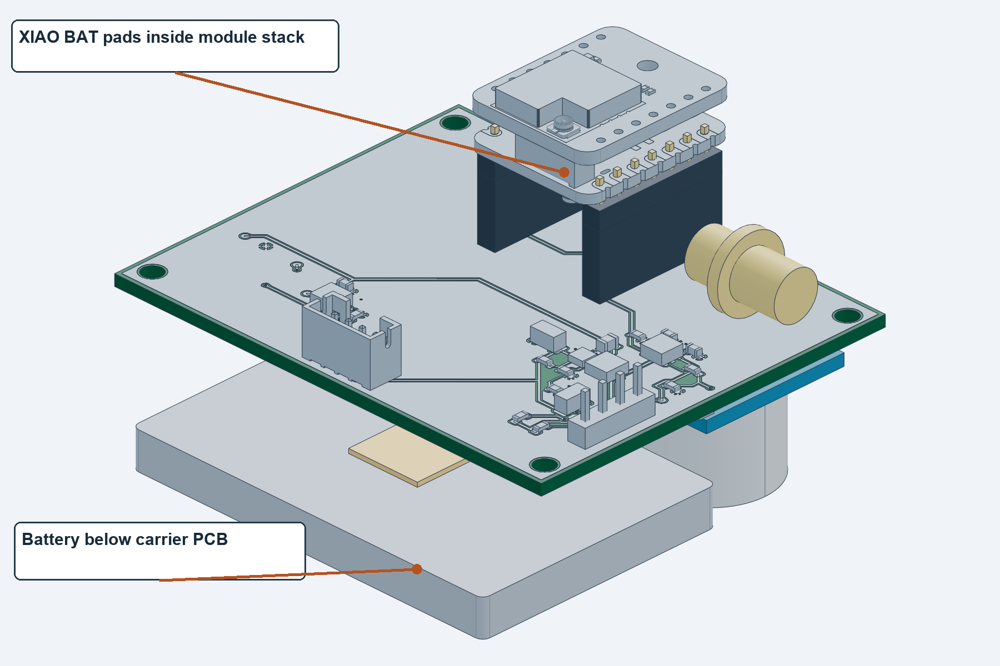
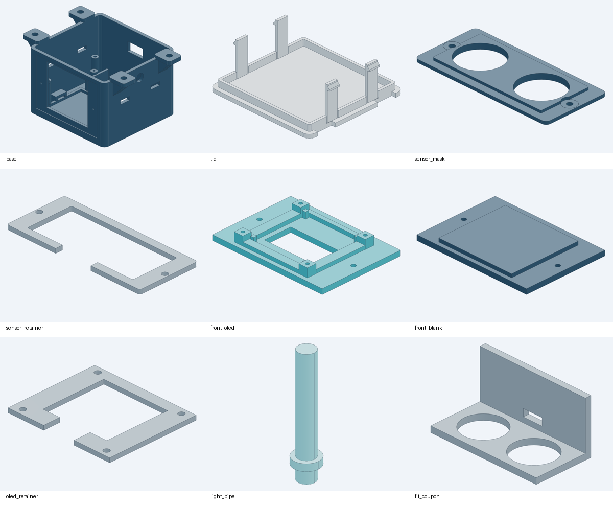

# SmartPark Revision D build guide

Final design package for the indoor low cost pilot. This guide covers the PCB, purchased parts, assembly, firmware connections, battery, solar input and two enclosure variants. Updated 26 October 2026.

## Product and application

One node mounts above a parking bay with both HC-SR04 transducers facing the floor. Firmware compares measured distance against a calibrated empty bay and sends occupancy over LoRa to a separate receiver or gateway and dashboard. The node does not include a gateway or application server.

| Property | Selected design |
| --- | --- |
| Controller and radio | XIAO ESP32S3 with Wio-SX1262 kit |
| Sensing | HC-SR04, indoor, ceiling height up to 2.8 m |
| Update target | Distance sample every 5 to 10 seconds; event based radio reporting |
| Board and case | 62 x 50 x 1.6 mm PCB; closed body 70 x 66 x 50.4 mm; ears extend width to 94 mm |
| Versions | Same PCB Gerbers; optional OLED population and interchangeable front panel |

Release status: digitally checked files for a first prototype. Electrical operation, battery life, sensor fit, printed latch life and installed RF performance require physical validation.

# Models and file map

Open GLB files for fast rotation and STEP files for CAD measurement. The numbered previews folders contain copies of the final models, not older revisions. Manufacturing STL and 3MF files remain under cad.

| Folder | Contents |
| --- | --- |
| previews/01-pcb | Carrier STEP, front and back copper SVG, assembly SVG |
| previews/02-connected-electronics | Carrier, module stack, sensor, battery and RF connector references in STEP and GLB |
| previews/03-enclosure | OLED and blank enclosure assemblies plus individual part GLBs |
| previews/04-complete-product | Closed and exploded complete products, both variants, STEP and GLB |
| previews/05-images | PCB, electronics, battery placement, parts and finished product images |
| hardware and outputs | Editable KiCad sources, Gerbers, drills, schematic, BOM and placement files |

Some purchased bodies are clearance envelopes. Solder fillets, flexible wiring, fasteners and the finished tuned antenna are not fully modeled. The models describe intended assembly, not a photograph of built hardware.

# PCB front and back views

Front and back SVGs are native KiCad copper and silkscreen plots. The back preview is mirrored for viewing the underside. Fabrication Gerbers must be uploaded unchanged; never mirror them.

D1 RGB pixel and C7 are on the underside, facing the light pipe. Top and bottom component outlines are also available as assembly-front.svg and assembly-back.svg. Both variants use the same two layer 1.6 mm FR4 fabrication files.

# Purchased modules and power parts

Buy the complete kit and exact display variant. Product links identify real listings or manufacturer ordering pages; they do not certify current stock, supplier quality or sample fit.

| Qty | Part | Selection and fit | Product source |
| --- | --- | --- | --- |
| 1 | XIAO ESP32S3 and Wio-SX1262 kit 102010611 | Controller, LoRa radio and antennas. Use the complete S3 kit, not the nRF52840 version. | [Seeed kit product](https://www.seeedstudio.com/Wio-SX1262-with-XIAO-ESP32S3-p-5982.html); [Robocraze kit](https://robocraze.com/products/xiao-esp32s3-wio-sx1262-kit-for-meshtastic-lora) |
| 1 | HC-SR04 ultrasonic module | 5 V sensor. Nominal 2 cm to 4 m; intended mounting height up to 2.8 m indoors. | [Robu HC-SR04 SKU 2444](https://robu.in/product/hc-sr04-ultrasonic-range-finder/) |
| 0 or 1 | GoldenMorning GME12864-11 OLED | Optional 0.96 inch 128x64 SSD1306 I2C, white. PCB 27.8 x 27.5 mm; max module 3.5 mm. | [Robu OLED SKU 617725](https://robu.in/product/0-96-inch-i2c-iic-oled-lcd-module-4pin-with-vcc-gnd-white/) |
| 1 | Protected 1S LiPo pouch pack | 3.7 V nominal, 4.2 V full; target 1500 mAh. Entire delivered pack must fit 51 x 34 x 5 mm. Candidate is not procurement approved. | [Probots protected pack candidate](https://probots.co.in/lithium-ion-rechargeable-battery-3-7v-1500mah-kp-053450.html) |
| 0 or 1 | External regulated solar source | FIT0601 5 V USB output, nominal 6 W panel. Requires USB-A to USB-C cable and outdoor panel mount. | [DFRobot FIT0601](https://www.dfrobot.com/product-1774.html); [Evelta FIT0601](https://evelta.com/monocrystalline-solar-panel-5v-1a/) |

## Battery location and electrical connection

The pouch rests flat in the base tray beneath the carrier PCB, toward the OLED or blank front panel. The HC-SR04 occupies the adjacent bottom area. Place 1 mm insulating foam below the pouch and retain it with a nonconductive strap.

There is no battery connector on the carrier PCB. The protected pack connects through a matching two pin pigtail soldered to the XIAO BAT plus and BAT minus pads before the Wio board is attached. Verify actual pad labels and connector polarity. The symbol J4 is an off board contact, not a part to solder onto the carrier.

The Probots pack is a sourcing candidate only and was listed out of stock at review. Its advertised size is approximately 50 x 34 x 5 mm. Obtain the total protected pack dimensions including PCM, pouch seals and lead exit before ordering.

# Components to solder onto the carrier

A fabricated bare PCB contains no electronic parts. Fit the following components unless supplied as an assembled PCB. The boost exposed pad needs a controlled reflow process. Verify pin 1 and the special bottom pixel pad mapping before soldering.

| Refs | Qty | Part or value | Package and assembly note | Product source |
| --- | --- | --- | --- | --- |
| U2 | 1 | TPS61099DRVR | Adjustable boost, WSON-6 with exposed pad, 2 x 2 mm. Requires reflow. | [TI TPS61099 product and ordering](https://www.ti.com/product/TPS61099) |
| U3 | 1 | SN74LVC1T45DBVR | SOT-23-6, 3.3 V to switched 5 V pixel data. | [TI SN74LVC1T45 product and ordering](https://www.ti.com/product/SN74LVC1T45) |
| U4 | 1 | SN74LVC1G17DBVR | SOT-23-5, 5 V tolerant ECHO buffer to MCU. | [TI SN74LVC1G17 product and ordering](https://www.ti.com/product/SN74LVC1G17) |
| D1 | 1 | WS2812B-2020-V6 | 2 x 2 mm, bottom side. Exact V6 pad map; do not substitute generic WS2812. | [Worldsemi exact pixel listing](https://lcscindia.com/part/WS2812B-2020-V6) |
| L1 | 1 | VLS3012CX-2R2M-1 | TDK 2.2 uH, 3 x 3 x 1.2 mm. | [TDK exact inductor](https://product.tdk.com/en/search/inductor/inductor/smd/info?part_no=VLS3012CX-2R2M-1) |
| C1 | 1 | GRM21BR71A106KE51L | 10 uF, 10 V X7R, 0805. | [Murata input capacitor](https://www.digikey.com/en/products/detail/murata-electronics/GRM21BR71A106KE51L/965919) |
| C2 C3 | 2 | GRM31CZ71C226ME15L | 22 uF, 16 V X7R, 1206. Preserve DC bias margin. | [Murata output capacitor](https://www.digikey.com/en/products/detail/murata-electronics/GRM31CZ71C226ME15L/13904808) |
| C4 C5 C6 C7 | 4 | 100 nF, 16 V X7R, 0603 | Example sourcing MPN GRM188R71C104KA01D. C7 is bottom side. | [Murata 100 nF candidate](https://www.mouser.com/ProductDetail/Murata-Electronics/GRM188R71C104KA01D) |

C4 and C6 bypass the 3.3 V logic supplies; C5 and C7 bypass the switched 5 V supplies. Keep the exact input and output capacitor families or recheck DC bias derating before substitution. Test pads TP1 to TP5 and four mounting holes need no parts.

# Carrier passives and connectors

The passive MPNs marked candidate are sourcing examples for the released generic values and footprints. They are not a silently changed KiCad BOM. Review their dimensions and ratings with the assembler.

| Refs | Qty | Part or value | Package and assembly note | Product source |
| --- | --- | --- | --- | --- |
| R1 | 1 | 1 Mohm, 1%, 0603 | Candidate RC0603FR-071ML, 0.1 W. | [Yageo 1 Mohm candidate](https://www.mouser.com/ProductDetail/YAGEO/RC0603FR-071ML) |
| R2 | 1 | 249 kohm, 1%, 0603 | Candidate RC0603FR-07249KL, 0.1 W. | [Yageo 249 kohm candidate](https://www.digikey.com/en/products/detail/yageo/RC0603FR-07249KL/727086) |
| R3 R4 R6 R7 | 4 | 100 kohm, 1%, 0603 | Candidate RC0603FR-07100KL, 0.1 W. | [Yageo 100 kohm candidate](https://www.digikey.com/en/products/detail/yageo/RC0603FR-07100KL/726889) |
| R5 | 1 | 330 ohm, 1%, 0603 | Candidate RC0603FR-07330RL, 0.1 W. | [Yageo 330 ohm candidate](https://www.digikey.com/en/products/detail/yageo/RC0603FR-07330RL/727162) |
| R8 R9 | 2 or 0 | 4.7 kohm, 1%, 0603 | OLED only; candidate RC0603FR-074K7L. | [Yageo 4.7 kohm candidate](https://www.mouser.com/ProductDetail/YAGEO/RC0603FR-074K7L) |
| J1 | 1 | JST B4B-PH-K-S LF SN | Through hole, 1x4 at 2 mm. Verify housing matches chosen cable. | [JST B4B-PH-K-S](https://www.digikey.com/en/products/detail/jst-sales-america-inc/B4B-PH-K-S/926613) |
| J2 | 1 or 0 | 1x4 male header, 2.54 mm | OLED only. Cable to display; display is not soldered directly to carrier. Standard pin-header stock; select fit. | See OLED product and assembly drawing |
| U1 interface | 2 | 1x7 female socket, 2.54 mm | Required body height 8.5 mm. Samtec SSW-107-01-T-S is an 8.51 mm dimensional candidate; complete stack still needs trial fit. | [Samtec socket dimensional candidate](https://www.digikey.com/en/products/detail/samtec-inc/SSW-107-01-T-S/1112298) |
| XIAO edge pads | 2 | 1x7 male header, 2.54 mm | 2.5 mm plastic shoulder; XIAO-side short legs at least 3 mm. Leave 0.6 mm air gap above plastic using removable shim. | Exact supplier MPN remains to be confirmed against these dimensions |

OLED version: fit J2, R8 and R9. No OLED version: omit all three plus the OLED module and cable. The shared Gerbers support both. Use outputs/BOM.csv or BOM-no-OLED.csv and the corresponding SMD placement file.

U1 is two through hole sockets, not an SMT XIAO module. The 0.6 mm air gap above the male plastic is mandatory for the modeled USB mounting tab clearance. The temporary soldering shim is removed after soldering.

# Harnesses and mechanical hardware

These items are required in addition to the fabricated board and soldered electronics. Harnesses, exact male headers, antenna and screws remain dimension controlled selections rather than procurement cleared MPNs.

| Item | Qty | Specification | Fit check |
| --- | --- | --- | --- |
| Sensor cable | 1 | JST-PH4 mating housing and contacts to four 2.54 mm female sensor sockets. Pin-to-pin continuity is required. | Match J1 and actual HC-SR04 male header |
| Battery lead | 1 | Matching PH2 battery mate to two insulated wires soldered to XIAO BAT pads before Wio is mated. | Pack connector polarity is not standardized |
| OLED cable | 0 or 1 | Flexible four-wire lead, 2.54 mm mating female ends. | GND, 3V3, SCL, SDA; match product pin labels |
| RF parts | 1 set | Use kit LoRa antenna for first bench test; selected 865 MHz external antenna and U.FL to SMA bulkhead lead for case mounting. | 6.6 mm case bore; connector body, coax bend and antenna MPN not frozen |
| Battery retention | 1 set | 1 mm insulating foam and nonconductive strap. | Never compress or puncture pouch |
| USB cable | 1 | Data-capable USB-C for upload; regulated solar cable instead for charging. | Slim plug must fit 14 x 7.6 mm opening |
| Fasteners | 1 set | 4x M2x4 sensor/mask; 2x M2x6 front panel; OLED adds 4x M2x5. Carrier: 4x M2.5-class screws, trial M2.5x6. | Printed pilot bores; verify engagement, no bottoming or battery contact |
| Installation | 1 set | Four suitable ceiling anchors and secondary retention for the actual ceiling material. | Mounting holes 4.5 mm, centers 82 x 42 mm |

Use the connector product links on the preceding pages to source mating families, then check continuity with a meter. A JST PH sensor connector has 2 mm spacing; the HC-SR04 module header uses 2.54 mm spacing. A straight four wire cable must map between them correctly.

# Programming pinout and peripheral cables

Use GPIO numbers below when configuring firmware. D labels are the Seeed board names. Full pad orientation and all reserved connections are in docs/PINOUT.md and outputs/schematics.png.

| Signal | XIAO pad | ESP32 S3 pin | Function |
| --- | --- | --- | --- |
| HC_TRIG | D0 | GPIO1 | Output; 10 us pulse to J1 pin 2 |
| ECHO_GPIO | D1 | GPIO2 | Input from U4 buffer; never raw 5 V ECHO |
| BOOST_EN | D3 | GPIO4 | Output active high; low disables sensor and RGB supply |
| OLED SDA | D4 | GPIO5 | I2C data to J2 pin 4 |
| OLED SCL | D5 | GPIO6 | I2C clock to J2 pin 3 |
| RGB data | D6 | GPIO43 | WS2812 data through U3; also UART0 boot TX |
| Reserved | D2 | GPIO3 | Strapping pin; leave unconnected |
| Wio SPI | D8 D9 D10 | GPIO7 GPIO8 GPIO9 | Reserved by kit radio; not available to carrier peripherals |

## Ultrasonic connector J1

| J1 pin | Connect to HC-SR04 | Electrical path |
| --- | --- | --- |
| 1 | VCC | Switched 5V_SENSOR |
| 2 | TRIG | D0 / GPIO1, 3.3 V output |
| 3 | ECHO | Raw sensor echo to U4; buffered output goes to D1 / GPIO2 |
| 4 | GND | Common return |

## Optional OLED connector J2

Pin 1 GND, pin 2 3V3, pin 3 SCL to GPIO6, pin 4 SDA to GPIO5. Power the module at 3.3 V. Scan the I2C bus to determine the delivered address; do not assume 0x3C without testing. Review onboard display pullups alongside carrier R8 and R9.

RGB D1 is already on the PCB, not an external LED socket. Configure one WS2812 compatible pixel on GPIO43 through U3. Verify color order on the first unit. It shares 5V_SENSOR with HC-SR04; turning the boost off turns both off.

# Battery fit charging and external solar

Recommended starting capacity is 1500 mAh, about 5.55 Wh nominal at 3.7 V. Use a protected single cell LiPo or equivalent 4.2 V charge pouch pack. Do not use a 3.2 V LiFePO4 pack, two cells in series or an 18650 in this unchanged tray.

Reference battery envelope is 51 x 34 x 5 mm, plus 1 mm foam beneath. The nominal tray is about 52 x 35 mm; seals, PCM, strain relief and lead routing must remain clear. Capacity labels do not establish fit. A larger capacity needs a separately checked pack or case redesign.

Feed an externally regulated 5 V solar USB output into the XIAO USB-C port. Use service USB or solar, one at a time. The XIAO is the only cell charger; no raw panel input, MPPT or parallel cell charger is on the carrier.

Seeed sources disagree on fast charge current: the general XIAO page lists 50 mA and the kit page lists 100 mA. Verify the delivered board. For 1500 mAh, capacity divided by those currents is already 15 to 30 hours before charge taper and running load. A short sunny period does not fully recharge an empty battery.

[Seeed XIAO power and pads](https://wiki.seeedstudio.com/xiao_esp32s3_getting_started/); [Seeed kit documentation](https://wiki.seeedstudio.com/wio_sx1262_with_xiao_esp32s3_kit/); [DFRobot FIT0601](https://www.dfrobot.com/product-1774.html)

# Estimated battery runtime

Planning result for a 1500 mAh pack is about 12 to 61 days, depending on firmware awake time and sample interval. This is a scenario calculation, not a measured lifetime. Use the no OLED variant for the first battery life test.

| Poll interval | Wake scenario | Average at battery | Estimated days |
| --- | --- | --- | --- |
| 5 s | fast wake | 1.54 mA | 32.5 |
| 5 s | slower wake | 4.3 mA | 11.6 |
| 10 s | fast wake | 0.82 mA | 61.0 |
| 10 s | slower wake | 2.2 mA | 22.7 |

Model assumptions: 80% usable capacity (1200 mAh); whole node sleep 0.05 mA; fast wake 60 mA for 0.12 s or slower wake 70 mA for 0.30 s; a separate 150 mA radio event for 0.10 s every 300 s. WiFi and BLE are off. OLED is omitted or in a verified low current display off mode. RGB only flashes briefly and the boost is off between polls.

Average mA = sleep mA + awake mA x awake seconds / poll seconds + radio mA x radio seconds / report seconds. Days = 1500 x 0.8 / average mA / 24. All model currents are battery side; do not add a second converter efficiency factor to them.

Research basis: Seeed lists 22 mA operating and 14 uA deep sleep for the base XIAO. The Wio module sheet lists 1.62 uA sleep, 7.6 mA receive and 125 mA transmit at 22 dBm. The HC-SR04 manual budgets 15 mA at 5 V. A conservative conversion estimate needs about 27 mA extra from 3.3 V during sensing at 85% boost efficiency; this is part of the assumed 60 to 70 mA awake total.

Continuous RGB holds the shared sensor rail on. The sensor alone can add roughly 27 mA before the MCU and LED load: at 30 to 60 mA total the same usable capacity gives about 20 to 40 hours. An always awake controller can also reduce life to days. Continuous OLED or radio receive further reduces it.

At 5 mA additional battery side display load, the 10 s fast wake example drops from 61 days to about 8.6 days; at 15 mA it drops to about 3.2 days. Those display loads are illustrative, not measured OLED specifications.

The radio budget assumes short occasional LoRa reports. LoRaWAN receive windows, joins, high spreading factors, retries and frequent events require a new measured budget. Solar can extend runtime only when measured daily harvested energy exceeds total node demand.

[Seeed XIAO power and pads](https://wiki.seeedstudio.com/xiao_esp32s3_getting_started/); [Seeed radio datasheet](https://files.seeedstudio.com/products/SenseCAP/Wio_SX1262/Wio-SX1262_Module_Datasheet.pdf); [HC-SR04 supplier manual](https://robu.in/wp-content/uploads/2020/02/edited_HC-SR04-User-Manual-1-converted-converted.pdf)

# Enclosure print parts and assembly

OLED version installs seven printed parts; status only installs six. Across both variants there are eight distinct installed part designs plus one optional fit coupon, nine print files total. Print individual STL or 3MF parts, never product or electronics assemblies.

| Part name | OLED qty | No OLED qty | Purpose |
| --- | --- | --- | --- |
| base | 1 | 1 | Main shell, tray, standoffs and mounting ears |
| lid | 1 | 1 | Four releasable snap clips |
| sensor_mask | 1 | 1 | Two sensor face openings only |
| sensor_retainer | 1 | 1 | Edge clamp above HC-SR04 |
| light_pipe | 1 | 1 | Clear PETG or suitable 3 mm clear rod |
| front_oled | 1 | 0 | OLED bezel and panel |
| oled_retainer | 1 | 0 | Holds display behind front panel |
| front_blank | 0 | 1 | Closed panel for no OLED |
| fit_coupon | optional | optional | Trial print, not installed |

Start with PETG, 0.2 mm layers, 0.4 mm nozzle, four walls, five top and bottom layers, 30% infill. Use clear PETG for the light pipe. Inspect supports under opening roofs and ears; keep clip gaps free. Print the coupon first and validate the lid latch fit. See docs/PRINT_CHECK.md.

# Assembly and firmware bring up

1. Inspect and reflow the bare carrier with its exact BOM. Check U2 exposed pad, IC orientations, bottom pixel orientation, solder bridges and continuity before installing the module kit or battery.

2. Fit the two female sockets. Solder matching male headers to the XIAO edge pads with the removable 0.6 mm gap shim; remove the shim. Pre solder the battery pigtail to BAT pads. Mate Wio and plug the stack into the carrier with XIAO components facing down and USB toward the rear.

3. Fit sensor, foam, protected battery and strap, carrier, light pipe and chosen front panel. Use the retainer and mask screws without obstructing sensor faces. For OLED, header edge faces up and four wires run to J2. Keep wires clear of clips, transducers, RF antenna and pouch edges.

4. With the battery disconnected, begin with a current limited bench source through USB-C. Hold GPIO4 BOOST_EN low. Initialize GPIO1 TRIG and GPIO43 RGB data low before enabling the sensor supply. Verify 3V3 and approximately 5.016 V only when enabled.

5. Upload through a USB data cable using the XIAO ESP32S3 board target. If needed use the delivered board BOOT and RESET procedure. Remove external solar while programming. The stock Meshtastic image is not the parking firmware.

6. After enabling the boost, allow at least 60 ms before the first measurement. Pulse TRIG for 10 us, time ECHO with a bounded timeout, and space HC-SR04 triggers at least 60 ms. Validate 3.3 V trigger acceptance on the purchased sensor lot.

7. Configure OLED I2C on SDA GPIO5 and SCL GPIO6 if fitted. Configure one WS2812 compatible pixel on GPIO43. The radio uses Seeed internal kit wiring; carrier D8 to D10 remain reserved. Verify radio driver mapping from the kit documentation.

8. Calibrate the empty bay with the installed sensor pointing straight down. Test vehicle roofs, adjacent bays, no echo, timeouts, temperature and alignment. Use hysteresis and confirmation samples; two confirmations can double the occupancy update delay to 10 to 20 seconds.

9. For the target battery life, deep sleep between polls, sleep the radio, disable WiFi and BLE, extinguish RGB and disable the boost. Send on occupancy changes with an explicitly chosen heartbeat interval. Firmware is not included or qualified in this release.

10. Measure the complete battery current waveform, startup duration, transmit peaks and no sun runtime on the actual device. Check latch engagement and ceiling retention before installation.

# Fabrication checks and release limits

Upload outputs/SmartPark-RevD-PCB-Fabrication.zip to the board fabricator. It contains two copper layers, soldermask, silkscreen, paste, outline, separate plated and non plated drills, drill maps and job report. Keep every file at native scale and orientation.

| Check | Retained evidence |
| --- | --- |
| Native ERC and DRC | 0 reported violations; see verification/erc-final.json and drc-final.json |
| Routing and parity | 0 unrouted and 0 schematic parity issues |
| Independent electrical audit | 42 critical package pin checks; hashes bind PCB, schematic and board STEP |
| Mechanical checks | 116 checks, 0 failures, one unverified commodity sensor dimension assumption |
| Print and assembly files | 9 closed printable meshes; 5 saved electronics and product STEP/GLB assemblies checked |
| File integrity | SHA256SUMS.txt plus verification/delivery-check.json; preview copies checked against originals |

Native checks use the rule configuration in the delivered project, including its recorded ignored rule categories. Zero reported violations is not all possible manufacturing checks, EMC testing or production certification.

Before batch release, confirm exact battery protection and dimensions, socket and male header stack, sensor can pitch, OLED fit, print tolerances, latch cycling, installed mount strength, boost transient behavior, radio performance and measured runtime. The HC-SR04 enclosure is indoor only and has no IP rating.

Use an India appropriate radio profile and resolve applicable equipment and RF requirements before deployment. The 22 dBm datasheet number used in the current budget is not a transmit power recommendation for India.

The retained hardware, fabrication and mechanical geometry is unchanged from the checked RevD release. Documentation, organized preview copies, copper plots and package integrity records were added. Older FireBeetle designs and the working RevD folder were removed only after checking the retained release.
